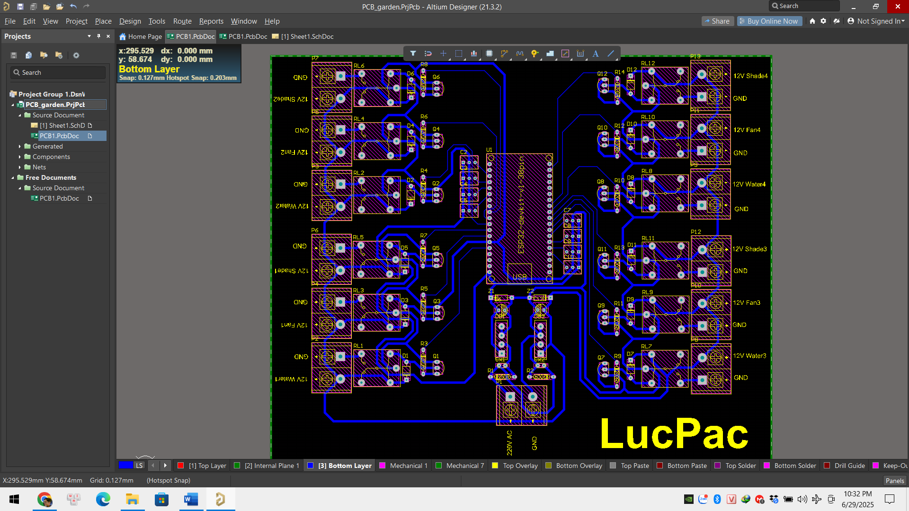
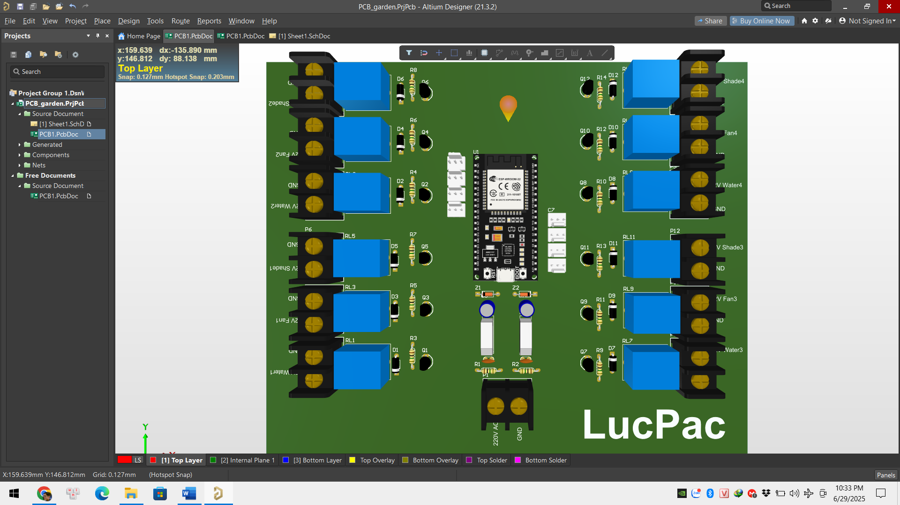
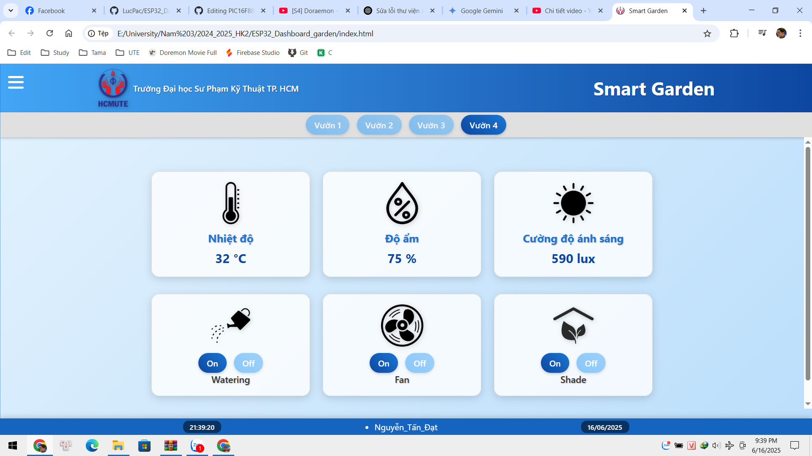
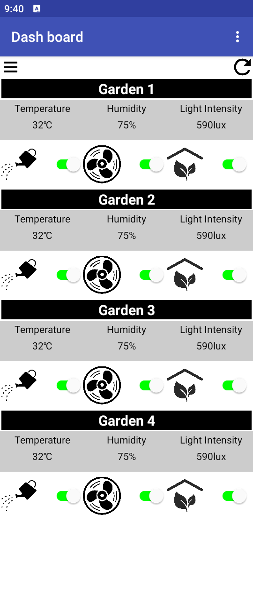
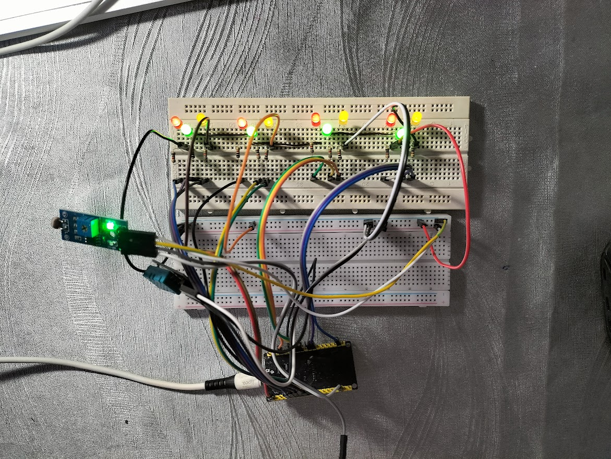
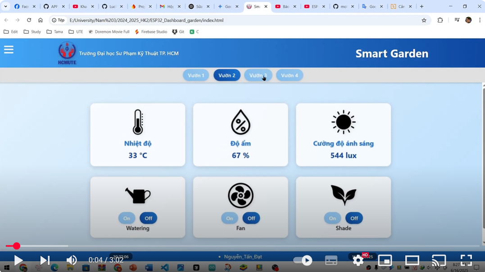

<div align="center">
  <h1>Smart Garden Monitoring & Control System - ESP32</h1>

</div>

<br>

## Overview

This project simulates a **smart plant environment monitoring and control system** based on **ESP32**. The system can:

- **Read data** from temperature, humidity, and light sensors.
- **Display in real-time** on **web dashboard/mobile app** (Firebase).
- **Control** watering, fan, and roof cover based on configured settings.

<br>

## How to Use

### Software Requirements
1. Arduino IDE / PlatformIO – Compile and upload code to ESP32.

2. Firebase Realtime Database – Store and sync monitoring data.

3. Mobile App / Web Dashboard – Remote control.

### Installation Steps
1. Download the project:
   
```bash
git clone https://github.com/LucPac/ESP32_Dashboard_garden.git
```
   
2. Open the folder with Arduino IDE or PlatformIO and configure:

    WiFi SSID & password  
  
    Firebase host & token

3. Upload the program to ESP32.

4. Open index.html in your browser or install the mobile app to monitor and control.

5. View temperature, humidity, light data and control devices with buttons.

<br>

## Features

```bash
| Component              | Function                                                |
|------------------------|---------------------------------------------------------|
| Temperature / Humidity | Read by DHT11 sensor                                    |
| Light                  | Read by photoresistor / LDR sensor                      |
| Watering               | Manual control                                          |
| Ventilation Fan        | Manual control                                          |
| Roof Cover             | Open/close by user command                              |
| Web/App Dashboard      | Display data and send control commands (via Firebase)   |
```

<br>

## Real Product  

PCB Layout




Dashboard Image



App Image

<div align="center">
  
</div>

Actual Circuit Image




Demo Video

[](assets/video/ESP32-Dashboard-control-smart-garden.mp4)

<br>